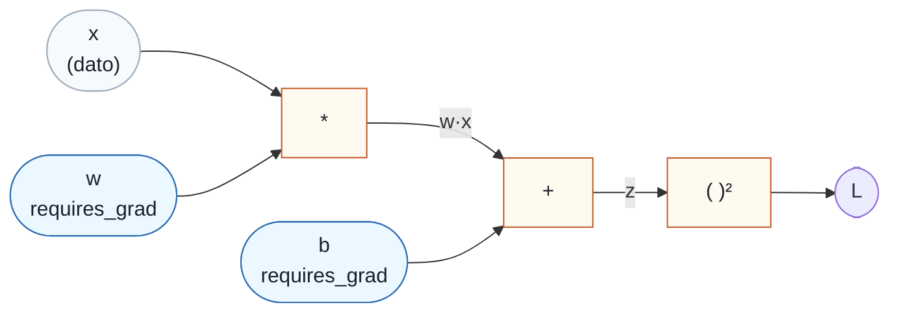
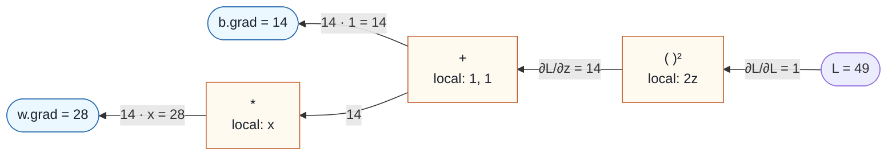
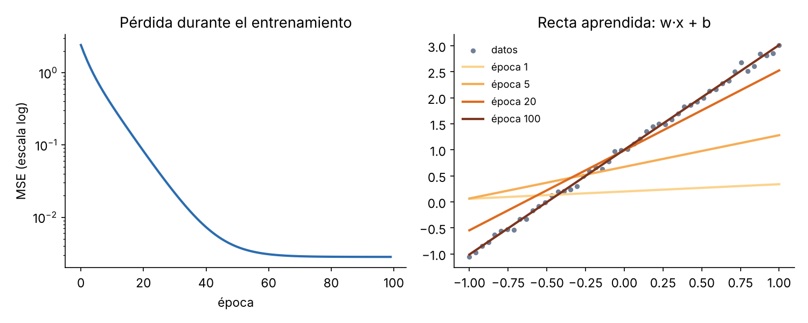
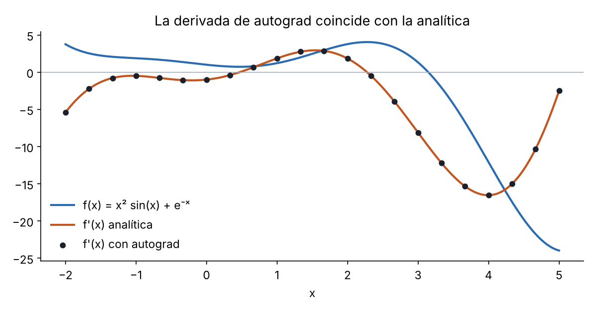

# Autograd en PyTorch: cómo funcionan los gradientes

Guía introductoria al motor de diferenciación automática de PyTorch: qué es el grafo computacional, qué hacen `requires_grad`, `backward`, `.grad`, `torch.autograd.grad`, `detach` y `no_grad`, y cómo encaja todo en un bucle de entrenamiento.

Todos los ejemplos se han ejecutado con PyTorch 2.x y las salidas que aparecen son las reales.

## Índice

1. [La idea: el grafo computacional](#1-la-idea-el-grafo-computacional)
2. [`requires_grad`, hojas y `grad_fn`](#2-requires_grad-hojas-y-grad_fn)
3. [Ejemplo mínimo: a mano y con autograd](#3-ejemplo-mínimo-a-mano-y-con-autograd)
4. [`backward()` en detalle](#4-backward-en-detalle)
5. [El atributo `.grad`](#5-el-atributo-grad)
6. [`torch.autograd.grad`](#6-torchautogradgrad)
7. [Cortar el grafo: `detach`, `no_grad`, `inference_mode`](#7-cortar-el-grafo-detach-no_grad-inference_mode)
8. [Ejemplo completo: regresión lineal](#8-ejemplo-completo-regresión-lineal)
9. [Aplicación: derivada de una función con autograd](#9-aplicación-derivada-de-una-función-con-autograd)
10. [Errores típicos](#10-errores-típicos)
11. [Chuleta](#11-chuleta)
12. [Ejercicios](#12-ejercicios)

---

## 1. La idea: el grafo computacional

Cuando operas con tensores que tienen `requires_grad=True`, PyTorch no solo calcula el resultado: **va apuntando cada operación** en un grafo dirigido. Ese grafo se construye **sobre la marcha** durante el forward (por eso se llama *grafo dinámico*: puede cambiar en cada iteración con `if` y bucles normales de Python).

Después, al llamar a `backward()`, PyTorch recorre ese grafo **al revés**, desde la salida hasta las entradas, aplicando la **regla de la cadena** en cada nodo. Esto es *reverse-mode automatic differentiation*, la base del backpropagation.

Para la función $L = (w x + b)^2$:



- Los nodos redondeados son **tensores**. `w` y `b` son las **hojas** del grafo: los tensores que creas tú y respecto a los que quieres derivar.
- Los nodos naranjas son **operaciones**. Cada una sabe calcular su propia derivada local.
- `x` es un dato: no requiere gradiente, así que autograd no calcula nada para él.

Dos fases:

| Fase | Qué pasa | Dirección |
|---|---|---|
| **Forward** | Se calculan los valores y se construye el grafo. Cada operación guarda lo que necesitará para derivar. | entradas → salida |
| **Backward** | `L.backward()` recorre el grafo aplicando la regla de la cadena y deja los gradientes en `.grad` de las hojas. Después, por defecto, **libera el grafo**. | salida → entradas |

---

## 2. `requires_grad`, hojas y `grad_fn`

Cada tensor lleva cuatro atributos relacionados con autograd:

| Atributo | Qué significa |
|---|---|
| `requires_grad` | Si autograd debe registrar las operaciones en las que participa este tensor. |
| `is_leaf` | Si es una **hoja**: un tensor creado por ti, no como resultado de una operación registrada. |
| `grad_fn` | La operación que creó el tensor (`AddBackward0`, `PowBackward0`, ...). Es `None` en las hojas. Es el "enlace" hacia atrás en el grafo. |
| `grad` | Donde `backward()` deja el gradiente $\partial L / \partial \text{tensor}$. **Solo se rellena en hojas con `requires_grad=True`.** |

Reglas de propagación:

- Si **alguna** entrada de una operación tiene `requires_grad=True`, la salida también lo tiene.
- Solo pueden requerir gradiente los tensores de tipo **flotante o complejo** (`float32`, `float64`, ...). Un tensor `int64` da error.

```python
import torch

x = torch.tensor(2.0)                       # dato
w = torch.tensor(3.0, requires_grad=True)   # parámetro
b = torch.tensor(1.0, requires_grad=True)   # parámetro

z = w * x + b
L = z ** 2

print(x.requires_grad, w.requires_grad, z.requires_grad, L.requires_grad)
# False True True True      <- z y L lo heredan de w y b

print(w.is_leaf, z.is_leaf, L.is_leaf)
# True False False          <- w lo creaste tú; z y L salen de operaciones

print(w.grad_fn, z.grad_fn, L.grad_fn)
# None <AddBackward0 ...> <PowBackward0 ...>
```

`L.grad_fn` es el punto de entrada del grafo hacia atrás. De hecho, puedes recorrerlo a mano:

```python
print(L.grad_fn.next_functions)
# ((<AddBackward0 ...>, 0),)    <- el nodo anterior a la potencia es la suma
```

Formas de activar `requires_grad`:

```python
w = torch.tensor(3.0, requires_grad=True)   # al crearlo
w = torch.randn(3).requires_grad_()         # in-place, sobre un tensor existente
w = torch.nn.Parameter(torch.randn(3))      # los parámetros de nn.Module ya lo traen activado
```

---

## 3. Ejemplo mínimo: a mano y con autograd

Seguimos con $L = (w x + b)^2$, en el punto $x = 2$, $w = 3$, $b = 1$.

### Forward

$$z = w x + b = 3 \cdot 2 + 1 = 7, \qquad L = z^2 = 49$$

### Backward a mano (regla de la cadena)

Se empieza por la salida, donde $\partial L / \partial L = 1$, y se va hacia atrás multiplicando por la derivada local de cada operación:

$$\frac{\partial L}{\partial z} = 2z = 14$$

$$\frac{\partial L}{\partial w} = \frac{\partial L}{\partial z} \cdot \frac{\partial z}{\partial w} = 14 \cdot x = 28$$

$$\frac{\partial L}{\partial b} = \frac{\partial L}{\partial z} \cdot \frac{\partial z}{\partial b} = 14 \cdot 1 = 14$$

Visualmente, el gradiente fluye en sentido contrario al forward:



Cada nodo recibe el gradiente que llega desde arriba (`grad_output`), lo multiplica por su derivada local y lo pasa hacia abajo. Eso es exactamente lo que hace el método `backward` de cada `grad_fn`.

### Lo mismo con autograd

```python
x = torch.tensor(2.0)
w = torch.tensor(3.0, requires_grad=True)
b = torch.tensor(1.0, requires_grad=True)

z = w * x + b
L = z ** 2

L.backward()

print(w.grad)   # tensor(28.)
print(b.grad)   # tensor(14.)
print(x.grad)   # None  <- x no requiere gradiente
print(z.grad)   # None  <- z no es hoja (y PyTorch avisa con un UserWarning)
```

Mismos números que a mano.

---

## 4. `backward()` en detalle

```python
tensor.backward(gradient=None, retain_graph=None, create_graph=False, inputs=None)
```

| Argumento | Qué hace | Por defecto |
|---|---|---|
| `gradient` | El "gradiente que llega desde arriba" a `tensor`. Obligatorio si `tensor` no es un escalar. | `None` (vale para escalares, equivale a `1`) |
| `retain_graph` | Si `True`, no libera el grafo tras el backward, para poder hacer otro. | `False` (salvo que `create_graph=True`) |
| `create_graph` | Si `True`, el propio cálculo del gradiente se registra en el grafo, para poder derivar otra vez (segundas derivadas). | `False` |
| `inputs` | Lista de tensores: solo se acumulan gradientes en ellos. | `None` (todas las hojas) |

### 4.1. Salidas no escalares: el argumento `gradient`

Si la salida es un vector, el gradiente no está definido sin más: hay un jacobiano entero. Por eso `backward()` sin argumentos solo funciona con escalares:

```python
x = torch.tensor([1.0, 2.0, 3.0], requires_grad=True)
y = x ** 2

y.backward()
# RuntimeError: grad can be implicitly created only for scalar outputs
```

Lo que calcula realmente `y.backward(v)` es el **producto vector-jacobiano** (VJP):

$$x.\text{grad}_j = \sum_i v_i \, \frac{\partial y_i}{\partial x_j} \qquad\Longleftrightarrow\qquad x.\text{grad} = v^\top J$$

Es decir, `v` hace el papel de $\partial L / \partial y$ para una pérdida $L$ implícita. Con `v` lleno de unos:

```python
y.backward(torch.ones_like(y))
print(x.grad)   # tensor([2., 4., 6.])   <- 2x
```

Que es lo mismo que sumar antes de derivar, porque la derivada de una suma respecto a cada sumando es 1:

```python
(x ** 2).sum().backward()
print(x.grad)   # tensor([2., 4., 6.])
```

Con otro `v`, cada componente se pondera:

```python
y = x ** 2
y.backward(torch.tensor([1.0, 0.0, 10.0]))
print(x.grad)   # tensor([ 2.,  0., 60.])   <- [1·2, 0·4, 10·6]
```

> El truco de `ones_like` solo sirve como "derivada en cada punto" si la función es **elemento a elemento**: entonces el jacobiano es diagonal y $v^\top J$ con $v = \mathbf{1}$ devuelve la diagonal. Con una función que mezcla componentes (softmax, una capa lineal...) obtendrías la suma de cada columna del jacobiano, no la derivada de cada componente.

### 4.2. Los gradientes se acumulan

`backward()` **suma** al `.grad` que ya hubiera; nunca lo sobrescribe:

```python
w = torch.tensor(3.0, requires_grad=True)

for _ in range(3):
    L = (w * 2.0 + 1.0) ** 2
    L.backward()
    print(w.grad)
# tensor(28.)
# tensor(56.)    <- 28 + 28
# tensor(84.)    <- 28 + 28 + 28

w.grad.zero_()
print(w.grad)    # tensor(0.)
```

Por eso en un bucle de entrenamiento hay que **poner a cero los gradientes en cada iteración** (`optimizer.zero_grad()`). Esta acumulación es intencionada: permite sumar gradientes de varios micro-lotes antes de actualizar (*gradient accumulation*) cuando el lote no cabe en memoria.

### 4.3. El grafo se libera tras el backward

Para ahorrar memoria, después de `backward()` se borran los tensores intermedios que guardó el forward. Un segundo backward sobre el mismo grafo falla:

```python
x = torch.tensor(2.0, requires_grad=True)
y = x ** 3

y.backward()
y.backward()
# RuntimeError: Trying to backward through the graph a second time ...
```

Si de verdad necesitas recorrerlo dos veces, usa `retain_graph=True` en el primero:

```python
y = x ** 3
y.backward(retain_graph=True)
y.backward()
print(x.grad)   # tensor(24.)   <- 3x² = 12, acumulado dos veces
```

En un entrenamiento normal no hace falta: cada iteración hace un forward nuevo y construye un grafo nuevo.

---

## 5. El atributo `.grad`

- Solo las **hojas con `requires_grad=True`** reciben `.grad`. En los tensores intermedios es `None`, porque guardarlo para todos gastaría mucha memoria.
- Si necesitas el gradiente de un intermedio, pídelo antes del backward con `retain_grad()`:

```python
w = torch.tensor(3.0, requires_grad=True)
z = w * 2.0 + 1.0
z.retain_grad()
L = z ** 2
L.backward()

print(z.grad)   # tensor(14.)  <- ∂L/∂z
print(w.grad)   # tensor(28.)
```

- Para limpiar el gradiente hay dos opciones:

```python
w.grad.zero_()   # lo pone a cero (el tensor sigue existiendo)
w.grad = None    # lo borra; el siguiente backward crea uno nuevo
```

`optimizer.zero_grad()` hace lo segundo por defecto (`set_to_none=True`), que es algo más eficiente.

---

## 6. `torch.autograd.grad`

Es la alternativa funcional a `backward()`: **devuelve** los gradientes en lugar de acumularlos en `.grad`.

```python
torch.autograd.grad(outputs, inputs, grad_outputs=None, retain_graph=None, create_graph=False)
```

```python
w = torch.tensor(3.0, requires_grad=True)
b = torch.tensor(1.0, requires_grad=True)
L = (w * 2.0 + b) ** 2

gw, gb = torch.autograd.grad(L, (w, b))
print(gw, gb)   # tensor(28.) tensor(14.)
print(w.grad)   # None  <- no ha tocado .grad
```

| | `L.backward()` | `torch.autograd.grad(L, inputs)` |
|---|---|---|
| Resultado | Se **acumula** en `.grad` de todas las hojas | Se **devuelve** como tupla, solo para `inputs` |
| Efecto en `.grad` | Lo modifica | No lo toca |
| Uso típico | Entrenar: después llega `optimizer.step()` | Gradientes respecto a la entrada (saliency, FGSM), segundas derivadas, penalizaciones de gradiente |
| Salida no escalar | argumento `gradient=` | argumento `grad_outputs=` |

Devuelve siempre una **tupla**, aunque pidas un solo tensor. Por eso verás `(grad,) = torch.autograd.grad(loss, x)`.

### Segundas derivadas con `create_graph=True`

Normalmente el cálculo del gradiente no se registra en el grafo. Con `create_graph=True` sí, de modo que el gradiente es a su vez derivable:

```python
x = torch.tensor(2.0, requires_grad=True)
y = x ** 3

(dy,) = torch.autograd.grad(y, x, create_graph=True)
print(dy)    # tensor(12., grad_fn=<MulBackward0>)   <- 3x², y tiene grad_fn

(d2y,) = torch.autograd.grad(dy, x)
print(d2y)   # tensor(12.)                           <- 6x
```

Es lo que usa la penalización de gradiente de WGAN-GP: la pérdida depende de un gradiente, y hay que poder derivarla respecto a los parámetros.

---

## 7. Cortar el grafo: `detach`, `no_grad`, `inference_mode`

A veces quieres operar con tensores **sin** que autograd lo registre.

| Herramienta | Qué hace | Cuándo usarla |
|---|---|---|
| `t.detach()` | Devuelve un tensor con los mismos datos (**comparte memoria**), sin `grad_fn` y con `requires_grad=False`. Es una hoja nueva. | Usar un valor como constante, pasarlo a NumPy, guardarlo en un log, hacer una copia "limpia" de una entrada. |
| `with torch.no_grad():` | Nada de lo que se calcule dentro construye grafo. | Actualizar parámetros a mano, evaluar un modelo. |
| `with torch.inference_mode():` | Como `no_grad`, pero más rápido y más estricto: los tensores creados dentro no pueden usarse después en autograd. | Inferencia pura. |
| `t.requires_grad_(False)` | Desactiva el gradiente de una hoja de forma permanente. | Congelar parámetros (*fine-tuning*). |

```python
w = torch.tensor(3.0, requires_grad=True)

d = (w * 2).detach()
print(d.requires_grad, d.is_leaf)   # False True

with torch.no_grad():
    y = w * 2
print(y.requires_grad)              # False
```

### Por qué la actualización de parámetros va dentro de `no_grad`

Modificar in-place una hoja que requiere gradiente está prohibido, porque autograd no sabría cómo derivar esa modificación:

```python
a = torch.tensor([1.0, 2.0], requires_grad=True)
a += 1
# RuntimeError: a leaf Variable that requires grad is being used in an in-place operation.
```

Dentro de `no_grad` sí se permite: le dices a PyTorch "esto no forma parte del modelo, es la actualización del optimizador":

```python
with torch.no_grad():
    a -= 0.1 * torch.ones(2)

print(a)   # tensor([0.9000, 1.9000], requires_grad=True)  <- sigue siendo hoja y requiriendo gradiente
```

### `detach()` frente a `detach().clone()`

`detach()` comparte memoria con el original: si luego modificas in-place el resultado, cambias también el tensor original. Si necesitas independencia total, añade `clone()`:

```python
x_copia = x.detach().clone()                       # datos propios, sin grafo
x_copia = x.detach().clone().requires_grad_(True)  # además, nueva hoja derivable
```

---

## 8. Ejemplo completo: regresión lineal

Ajustamos $\hat{y} = w x + b$ a datos generados con $y = 2x + 1 + \text{ruido}$, minimizando el error cuadrático medio con descenso de gradiente. Primero todo a mano, para ver cada pieza:

```python
import torch

torch.manual_seed(0)
X = torch.linspace(-1, 1, 50)
Y = 2 * X + 1 + 0.05 * torch.randn(50)

w = torch.zeros((), requires_grad=True)
b = torch.zeros((), requires_grad=True)
lr = 0.1

for epoch in range(100):
    # 1. Forward: se construye el grafo
    pred = w * X + b
    loss = ((pred - Y) ** 2).mean()

    # 2. Backward: se rellenan w.grad y b.grad
    loss.backward()

    # 3. Actualización: fuera del grafo
    with torch.no_grad():
        w -= lr * w.grad
        b -= lr * b.grad

    # 4. Limpiar gradientes para la siguiente iteración
    w.grad.zero_()
    b.grad.zero_()

print(w.item(), b.item())   # 2.0128... 1.0024...
```



La pérdida cae varios órdenes de magnitud y la recta pasa de casi horizontal a ajustarse a los datos.

### Lo mismo con `nn.Module` y un optimizador

Los cuatro pasos son los mismos; `nn.Linear` crea los parámetros con `requires_grad=True` y el optimizador encapsula los pasos 3 y 4:

```python
model = torch.nn.Linear(1, 1)
optimizer = torch.optim.SGD(model.parameters(), lr=0.1)

for epoch in range(100):
    pred = model(X[:, None]).squeeze(1)    # (50, 1) -> (50,)
    loss = ((pred - Y) ** 2).mean()

    optimizer.zero_grad()   # paso 4: limpiar (antes del backward)
    loss.backward()         # paso 2
    optimizer.step()        # paso 3: p -= lr * p.grad, dentro de no_grad
```

El orden `zero_grad` → `backward` → `step` es el patrón que verás en todos los bucles de entrenamiento.

---

## 9. Aplicación: derivada de una función con autograd

Un ejercicio típico: calcular $f'(x)$ en muchos puntos sin derivar a mano, para $f(x) = x^2 \sin x + e^{-x}$, sin modificar el tensor `x` que nos pasan.

```python
def df_autograd(fn, x):
    x = x.detach().clone().requires_grad_(True)   # copia independiente y derivable
    y = fn(x)                                     # forward: se construye el grafo
    y.backward(torch.ones_like(y))                # y no es escalar -> hace falta v = 1
    return x.grad.detach()                        # el gradiente, sin grafo
```

Línea a línea, con lo visto en esta guía:

1. **`x.detach().clone().requires_grad_(True)`**: si usáramos el `x` del usuario, le cambiaríamos `requires_grad`, escribiríamos en su `.grad` (y como se acumula, una segunda llamada daría el doble), y si `x` viniera de otro grafo, el backward se propagaría por él. Con la copia trabajamos sobre una hoja nueva y limpia (secciones 2, 4.2 y 7).
2. **`fn(x)`**: como la copia requiere gradiente, cada operación queda registrada (sección 1).
3. **`y.backward(torch.ones_like(y))`**: `y` tiene la forma de `x`, no es un escalar. Como `fn` actúa elemento a elemento, el jacobiano es diagonal y $v = \mathbf{1}$ devuelve exactamente $f'(x_i)$ en cada posición (sección 4.1). Equivale a `y.sum().backward()`.
4. **`x.grad.detach()`**: devuelve el gradiente de la copia. Sin `create_graph=True`, `x.grad` ya no tiene grafo, así que el `detach` es una garantía defensiva (sección 6).

Comprobación frente a la derivada analítica $f'(x) = 2x \sin x + x^2 \cos x - e^{-x}$:

```python
def f(x):
    return x**2 * torch.sin(x) + torch.exp(-x)

def df_analytic(x):
    return 2 * x * torch.sin(x) + x**2 * torch.cos(x) - torch.exp(-x)

xs = torch.linspace(-3, 3, 7)
print(torch.allclose(df_autograd(f, xs), df_analytic(xs)))   # True
print(xs.requires_grad, xs.grad)                             # False None  <- xs intacto
```



Los puntos negros (autograd) caen exactamente sobre la curva naranja (derivada analítica).

---

## 10. Errores típicos

| Error | Causa | Solución |
|---|---|---|
| `grad can be implicitly created only for scalar outputs` | `backward()` sobre un tensor no escalar. | Reducir a escalar (`.sum()`, `.mean()`) o pasar `gradient=`. |
| `element 0 of tensors does not require grad and does not have a grad_fn` | Ninguna entrada tenía `requires_grad=True`, o se calculó dentro de `no_grad`. | Activar `requires_grad` en las hojas; revisar que no haya un `no_grad` o un `detach` de más. |
| `Trying to backward through the graph a second time` | Dos `backward` sobre el mismo grafo. | Rehacer el forward, o `retain_graph=True` en el primero. |
| `a leaf Variable that requires grad is being used in an in-place operation` | Modificar in-place un parámetro fuera de `no_grad`. | Envolver la actualización en `with torch.no_grad():`. |
| `Only Tensors of floating point and complex dtype can require gradients` | `requires_grad=True` en un tensor entero. | Crear el tensor como `float`. |
| `Can't call numpy() on Tensor that requires grad` | Pasar a NumPy un tensor del grafo. | `t.detach().numpy()` (o `.cpu()` antes si está en GPU). |
| `.grad` es `None` | El tensor no es hoja, o no requiere gradiente. | `retain_grad()` antes del backward, o usar la hoja. |
| Los gradientes crecen en cada iteración | Falta `zero_grad()`. | `optimizer.zero_grad()` en cada iteración. |

---

## 11. Chuleta

```python
# Crear hojas derivables
w = torch.tensor(3.0, requires_grad=True)
w = torch.randn(3).requires_grad_()

# Inspeccionar
t.requires_grad, t.is_leaf, t.grad_fn, t.grad

# Calcular gradientes
L.backward()                              # L escalar: acumula en .grad de las hojas
y.backward(v)                             # y no escalar: calcula vᵀ J
L.backward(retain_graph=True)             # no libera el grafo
(g,) = torch.autograd.grad(L, x)          # devuelve el gradiente sin tocar .grad
(g,) = torch.autograd.grad(L, x, create_graph=True)   # g derivable (segundas derivadas)
z.retain_grad()                           # guardar .grad de un intermedio

# Limpiar
w.grad.zero_()
w.grad = None
optimizer.zero_grad()

# Cortar el grafo
t.detach()                                # misma memoria, sin grafo
t.detach().clone()                        # copia independiente, sin grafo
with torch.no_grad(): ...                 # nada se registra
with torch.inference_mode(): ...          # igual, más rápido, solo inferencia
p.requires_grad_(False)                   # congelar un parámetro

# Bucle de entrenamiento
optimizer.zero_grad()
loss = loss_fn(model(x), y)
loss.backward()
optimizer.step()
```

---

## 12. Ejercicios

Están en `autograd_basics.py` (la solución, en `solutions/fundamentals/02_autograd/`). Compruébalos con:

```bash
pytest tests/fundamentals/test_f02_autograd.py --target exercises
```

| # | Función | Qué practica | Sección | Dificultad |
|---|---|---|---|---|
| 1 | `df_analytic` | derivada hecha a mano | 9 | ★ |
| 2 | `df_autograd` | la misma derivada con `backward` | 3, 9 | ★ |
| 3 | `input_gradient` | gradiente respecto a la entrada, no a los pesos | 5, 6 | ★ |
| 4 | `saliency_map` | mapa de saliencia (explicabilidad) | 6 | ★★ |
| 5 | `fgsm` | ataque adversario de un paso | 6, 7 | ★★ |
| 6 | `manual_linear_relu_mse` | backward a mano de lineal + ReLU + MSE | 3 | ★★★ |
| 7 | `MySigmoid` | `torch.autograd.Function` propia | 4 | ★★ |
| 8 | `GuidedReLU` | backward modificado (*guided backprop*) | 4 | ★★ |
| 9 | `GradientReversal` | invertir el gradiente (adaptación de dominio) | 4 | ★★ |
| 10 | `register_gradient_scaler` | hooks de gradiente | 5 | ★★ |
| 11 | `second_derivative` | `create_graph=True` | 6 | ★★ |
| 12 | `gradient_penalty` | penalización del gradiente (WGAN-GP) | 6 | ★★★ |
| 13 | `freeze` | congelar parámetros | 7 | ★ |
| 14 | `train_with_accumulation` | acumulación de gradientes | 4.2, 8 | ★★ |